# Life OS Skills

Ready-made **AI agent skills** for running everyday life with an assistant. Each skill is a folder of plain instructions, reference files and small scripts. Your assistant follows it step by step: it asks you the right questions, builds the thing, and keeps it updated.

Skills follow the open `SKILL.md` format. They work in Claude (as an uploaded skill), and in any other assistant that can read files and run Python.

> **Sample data only.** Nothing in this repository is real personal data. Read the [Disclaimer](DISCLAIMER.md): these are tracking tools, not financial advice.

## Skills

| Skill | What it builds | Status |
|---|---|---|
| [Personal Finance Dashboard](skills/personal-finance-dashboard) | An interactive dashboard (India-first) covering monthly cash flow and a cash-flow forecast, cards and spending, investments (stocks, mutual funds, US stocks, EPF/PPF/NPS), a retirement-at-60 projection, card rewards, savings accounts, net worth, tax, goals, loans, bills and insurance. Works offline as a single file. | ✅ v1.5.1 |
| Card statement analyser | Category spend, milestone and fee-waiver tracking from monthly statements | Planned |
| Insurance review | Term and health cover gaps, premium history, renewals | Planned |

## Personal Finance Dashboard

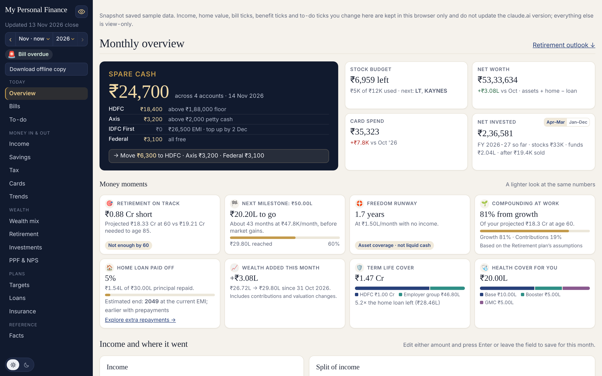

<table>
<tr><td>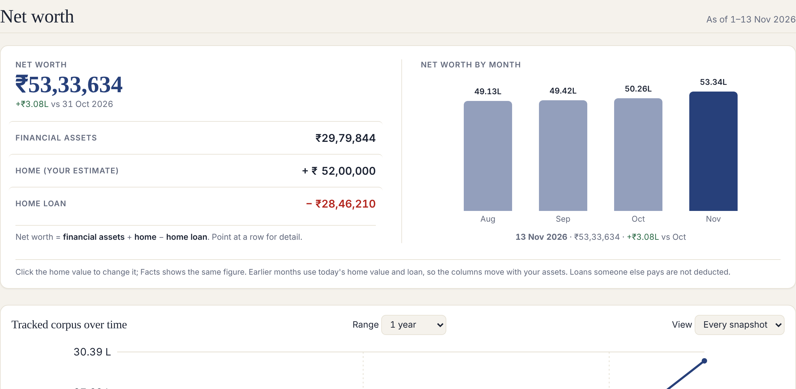</td><td>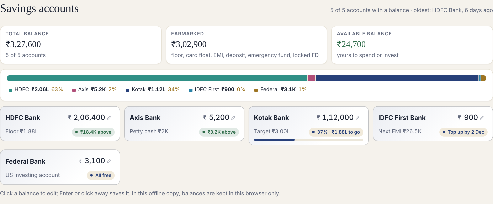</td></tr>
<tr><td>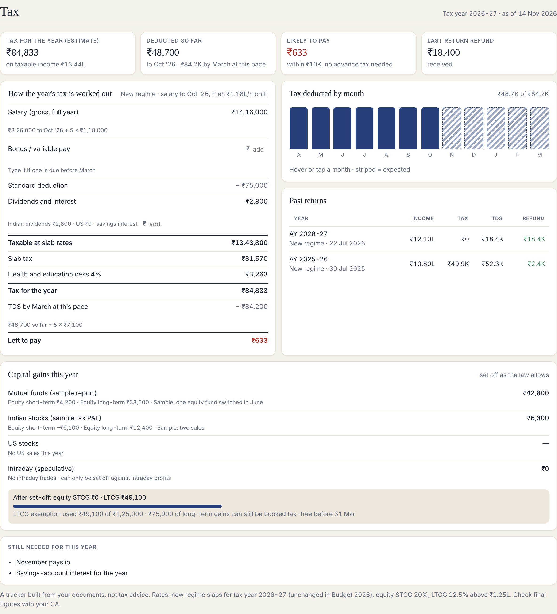</td><td>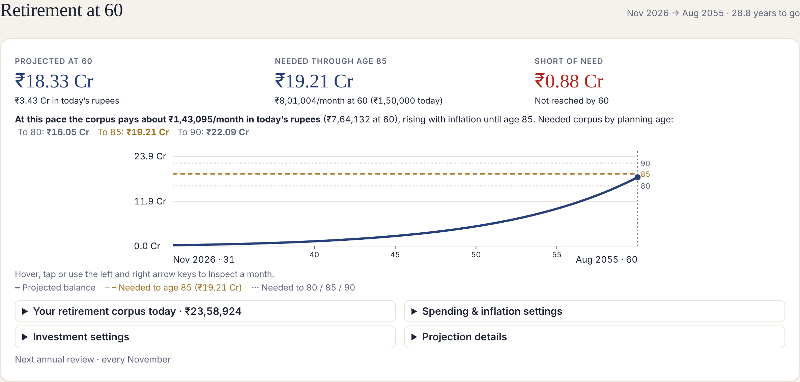</td></tr>
<tr><td>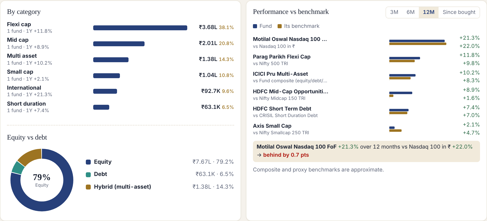</td><td>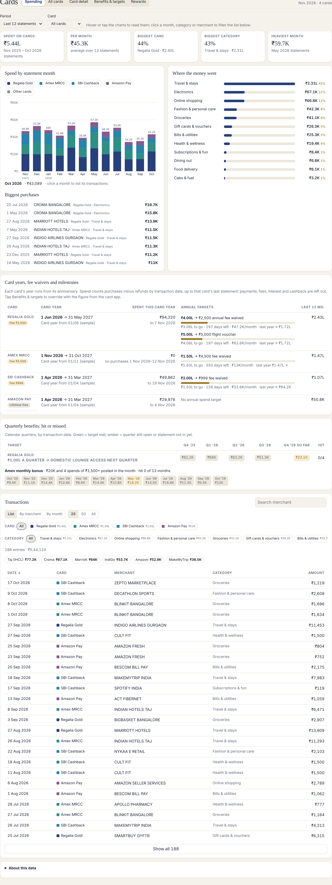</td></tr>
<tr><td>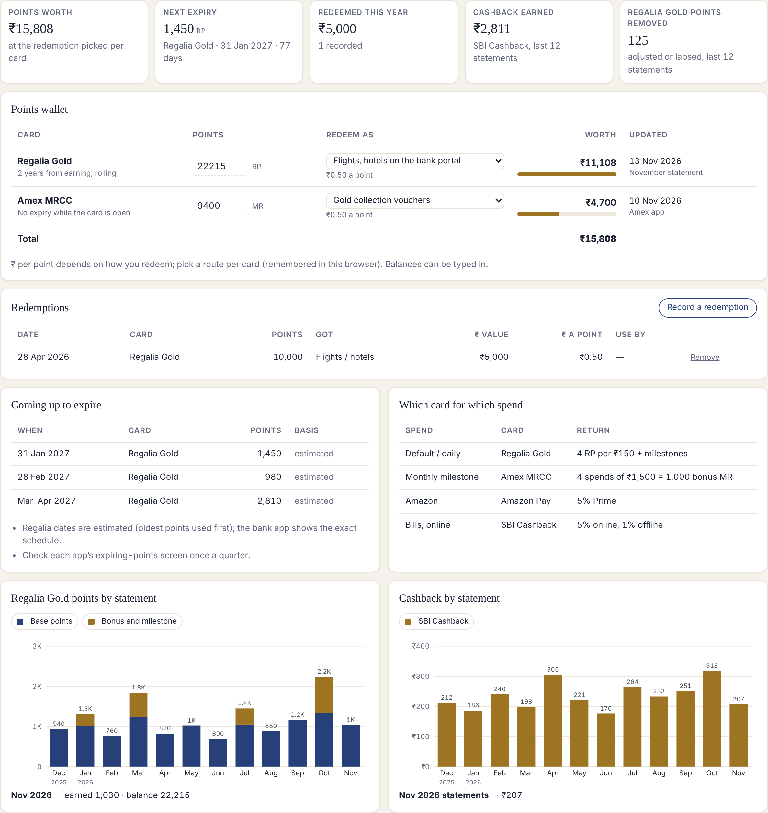</td><td>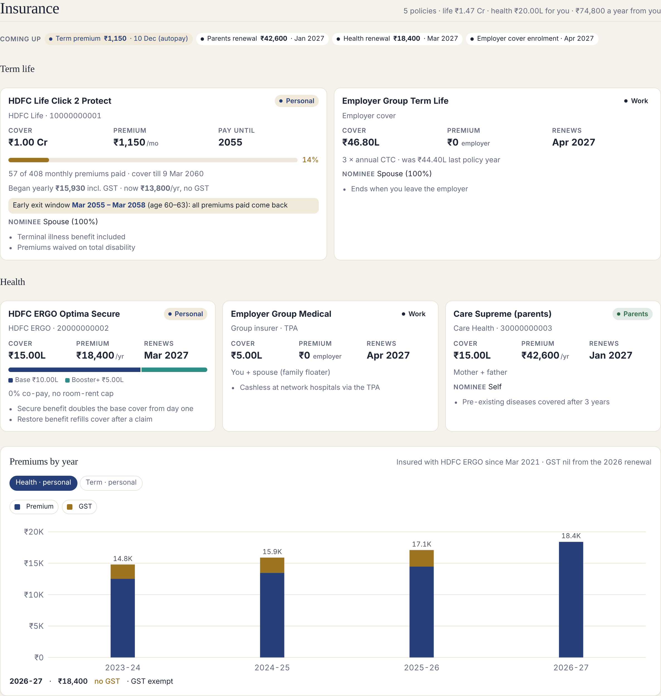</td></tr>
<tr><td>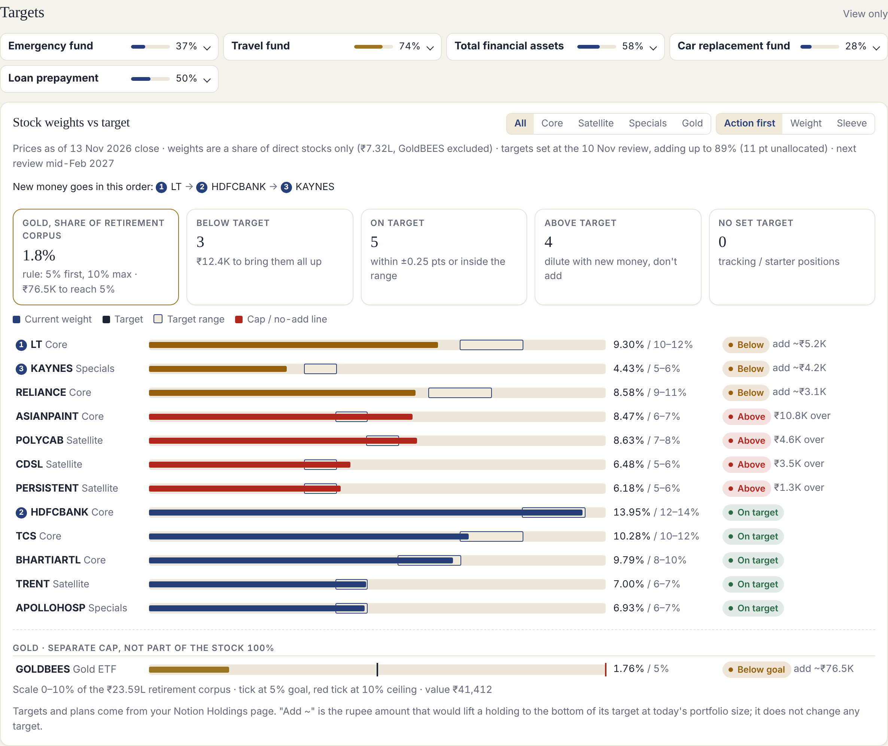</td><td>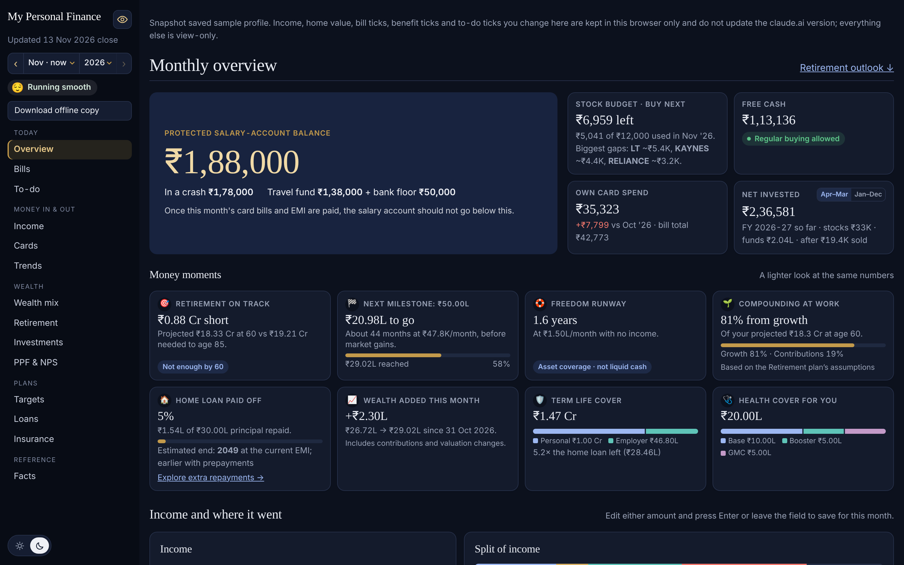</td></tr>
<tr><td colspan="2">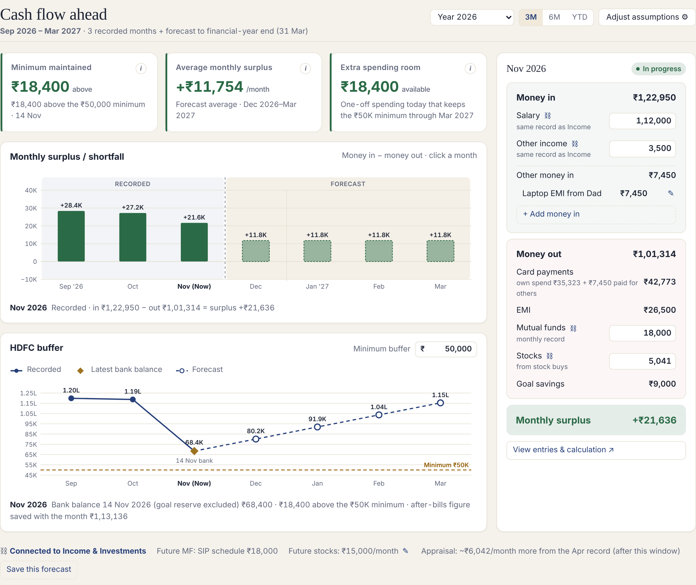</td></tr>
<tr><td>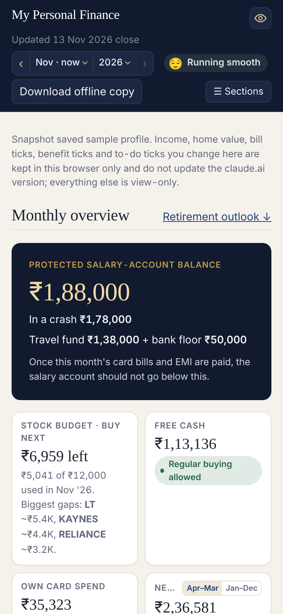</td><td></td></tr>
</table>

**Highlights**

- Every chart responds to hover, tap and arrow keys.
- Each mutual fund and US stock against its own benchmark: 3M, 6M, 12M and since bought (same buy dates put into the index).
- Retirement at 60 with a half-yearly check: actual corpus plotted against the saved plan, beat/miss columns per review.
- Card rewards: a points wallet valued at the redemption you pick, redemptions, expiry dates and cashback by statement.
- Spare cash across your bank accounts: what each account must hold, what is free and what to move to the salary account.
- Net worth (assets + home − loans) by month, and a tax-year estimate under the new regime with capital-gains set-off and TDS by month.
- Light / Dark switch (Light by default). Works on phones.
- An eye toggle hides salary and investment figures for screen-sharing.
- "Download offline copy" saves a single HTML file that works with no internet and no account.
- Data lives in a small database (or an embedded JSON for the offline file), never in the page code, so monthly updates are quick.

**Try it in 10 seconds:** download [`sample-dashboard.html`](skills/personal-finance-dashboard/assets/sample-dashboard.html) and open it in Chrome or Safari.

**What's new in v1.5.1** (18-Nov-2026): Cash flow ahead, a forecast to the financial-year end with action cards, editable months and an editable minimum buffer;: see the [changelog](CHANGELOG.md).

## How to use a skill

**Claude (claude.ai or the Claude app)**

1. Download [`personal-finance-dashboard-skill.zip`](dist/personal-finance-dashboard-skill.zip) (click **Download raw file** on that page). Every version is listed under [Releases](../../releases) and in the [changelog](CHANGELOG.md).
2. Upload it under **Settings → Capabilities → Skills**. The menu names can differ by plan.
3. In a new chat, say: *"Build my personal finance dashboard."*

**Any other assistant**

1. Download the same zip and unzip it.
2. Attach `SKILL.md` plus the files it lists. Then say: *"Follow SKILL.md to build my personal finance dashboard."*
3. The assistant needs to read files and run Python. Hosting the page is optional, because the skill can produce an offline file instead.

**What you'll be asked for** (Personal Finance)

The assistant works in five stages:

1. Setup
2. Cards: statements for the last 12 months
3. Investments: broker holdings and tradebook, mutual-fund statement (CAS), US holdings, EPF/PPF/NPS balances
4. Salary, savings accounts, tax, cash and loans
5. Insurance: policy schedules

Connectors (broker, investment aggregator, email, Notion) can speed this up. They are optional. See [connectors](skills/personal-finance-dashboard/references/connectors.md).

## Repository layout

```
skills/
  personal-finance-dashboard/
    SKILL.md              ← the instructions an assistant follows
    README.md             ← human quick-start
    assets/               ← template page, sample data, sample dashboard
    references/           ← full SOP & spec, connectors guide
    scripts/              ← build.py, make_offline.py, validate_data.py
dist/                     ← ready-to-upload skill zips
docs/images/              ← screenshots
```

## Privacy rule for contributors

Never commit real personal data: no statements, balances, policy numbers or exports. Pull requests that include anything other than clearly fictional sample data will be closed. `.gitignore` already blocks the usual personal files.

## License

[MIT](LICENSE). Free to use, change and share, with no warranty. See also the [Disclaimer](DISCLAIMER.md).
